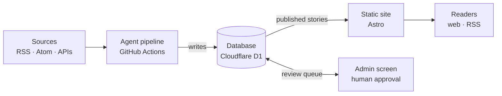

<div align="center">

# Radar

**The day's AI and agentic news for developers. Five minutes, no noise.**

Written by an agent. Approved by a human. Every claim linked to its primary source.

[radar.ozkanyusuf.com](https://radar.ozkanyusuf.com) · [How it works](#how-it-works) · [Quickstart](#quickstart) · [Suggest a source](#suggest-a-source)

[](https://github.com/ysfzkn/radar/actions/workflows/ci.yml)
[](LICENSE)
[](#status)

</div>

---

## Why

I missed A2UI. A protocol I ended up shipping in my own product, and I only heard about it from someone else, weeks late. The news was out there; it was buried under funding rounds, benchmark drama and forty rewrites of the same press release.

Radar is the feed I wanted: **one short edition a day, 5–8 stories, each ending with one line that answers "what does this mean for me as a developer?"** Then it stops. No infinite scroll, no ads, no pop-ups.

It is published in **Turkish and English**. Turkish comes first, because that is where a developer-focused daily was missing.

## What a story looks like

```
PROTOCOL · Nov 19                                    ●●●●○ 4 sources

A2UI reaches 1.0 release candidate

Google's protocol for agent-generated interfaces is now a release
candidate. The agent sends JSON; the client renders its own components.

→ For developers: if your chat UI needs a form or a table, you can try
  it without writing a custom component.

Source: a2ui.org · GitHub                            [ Try it today ]
Written by AI · auto-published
```

Two small signals carry a lot:

- **Echo meter** — how many independent sources covered the story. It separates what is actually making waves from what one blog is excited about.
- **Try it today** — shown when there is a repo or quickstart you can run right now.

## How it works



The pipeline has seven steps. **Four of them never call a model.**

| # | Step | Model | What it does |
| --- | --- | --- | --- |
| 1 | Collect | none | Pulls every source in `sources.yaml` |
| 2 | Deduplicate | none | Groups the same story across sources |
| 3 | Prefilter | none | Ranks and keeps the top 30 candidates |
| 4 | Score | small | One batched call: relevance, novelty, usefulness, risk flags |
| 5 | Write | mid | Builds a language-neutral fact card, then TR and EN text from it |
| 6 | Verify | none | Every number, version and name must appear in the source text |
| 7 | Route | none | Auto-publish, or send to the human review queue |

## Principles

- **Primary source or it does not run.** Community buzz is a signal, not a story. If the original announcement cannot be found, a human decides.
- **Nothing the source did not say.** A deterministic check rejects any number, version or proper noun that is missing from the source text.
- **Risky stories wait for a human.** Security incidents, accusations, funding figures, third-party benchmark claims and regulation always go to review. Unreviewed items expire after 72 hours; they are never published by default.
- **A budget, enforced in code.** The design target is under 30K tokens a day, with a hard daily spend cap. Token use per step is logged for every run.
- **We do not summarize the summarizers.** Other newsletters are used only to check what we missed, never as text to rewrite.
- **Labeled honestly.** Every story says whether a human approved it or it was auto-published.

## Status

Radar is being built in the open, one plan at a time.

- [ ] **1. Collector** — source registry, fetchers, deduplication, prefilter
- [ ] **2. Agent** — scoring, fact cards, bilingual writing, verification, token meter
- [ ] **3. Admin** — review queue, edit, approve, reject, expiry
- [ ] **4. Site** — daily edition, archive, topics, weekly digest, RSS
- [ ] **5. Automation** — scheduled runs, notifications, alerts
- [ ] **6. Launch**

## Quickstart

The collector runs locally with no API key and no account.

```bash
git clone https://github.com/OWNER/radar.git
cd radar/agent
uv sync
uv run pytest
uv run radar collect --show 5
```

```
{"sources_ok": 19, "sources_failed": 0, "new_items": 156, "new_clusters": 148, "candidates": 30, "llm_calls": 0, "failed": []}
 3.00  1  Accelerating development for massive Git repositories  https://developers.googleblog.com/accelerating-development-for-massive-git-repositories
 3.00  1  Gemini 4 Hydrogen: a faster model for general purpose robotics  https://developers.googleblog.com/gemini-hydrogen-for-robotics
 3.00  1  Build full-stack Android apps with Gemini in Google AI Studio  https://developers.googleblog.com/build-full-stack-android-apps-with-gemini-in-google-ai-studio
 3.00  1  Agents are sessions, not requests: size GKE node pools for AI agent sessions  https://developers.googleblog.com/agents-are-sessions-not-requests-size-gke-node-pools-for-ai-agent-sessions
 3.00  1  TPU Model Design Considerations and Optimization Guide  https://developers.googleblog.com/tpu-model-design-considerations-and-optimization-guide
```

Full instructions, including running your own Radar on your own domain: [docs/setup.md](docs/setup.md).

## Suggest a source

The source list is a plain file: [`sources.yaml`](sources.yaml). If Radar should be reading something it is not, [open a source suggestion](https://github.com/OWNER/radar/issues/new?template=source_suggestion.yml) or send a pull request. How sources are tiered and weighted: [docs/sources.md](docs/sources.md).

Turkish sources are especially welcome.

## Run your own

Radar is not tied to AI news. Change `sources.yaml` and the scoring prompt and you have a curated daily for any field. Hosting fits in free tiers; the only running cost is model usage.

## Contributing

Bug reports, source suggestions and pull requests are welcome. Start with [CONTRIBUTING.md](CONTRIBUTING.md). Found a story that is wrong or misleading? That is the most valuable report there is — please open an issue with the story link.

Security issues: see [SECURITY.md](SECURITY.md).

## License

Code is released under the [MIT License](LICENSE).

## Author

Built by [Yusuf Özkan](https://ozkanyusuf.com) as a side project.
